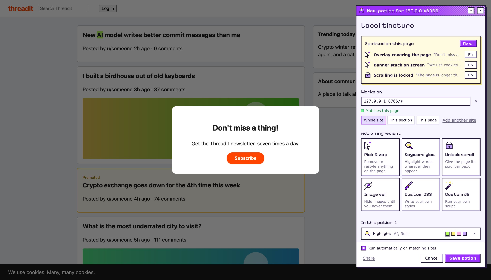
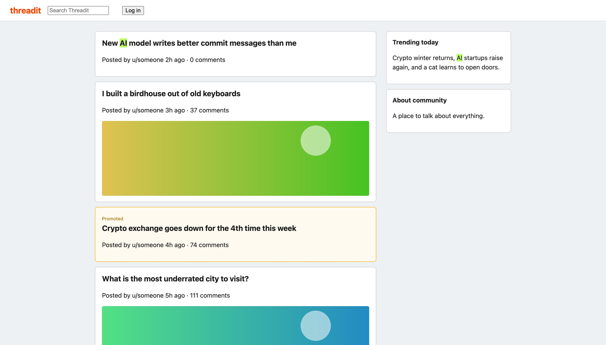
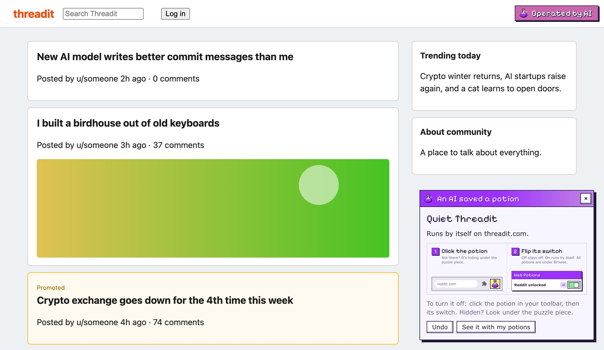
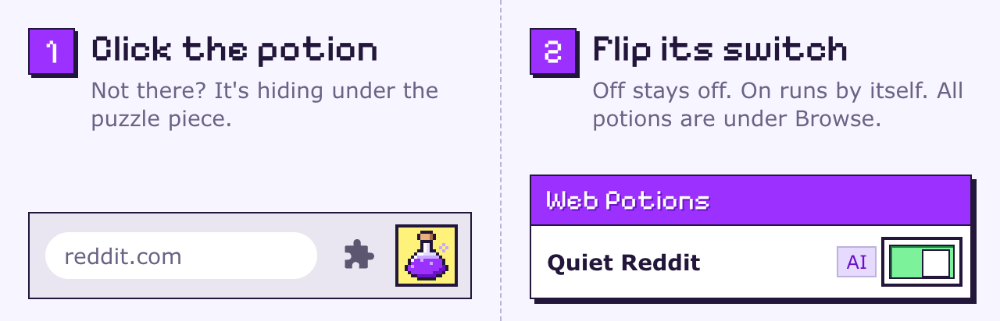
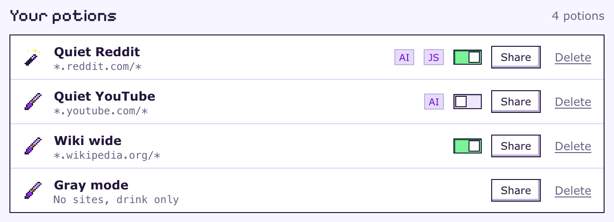
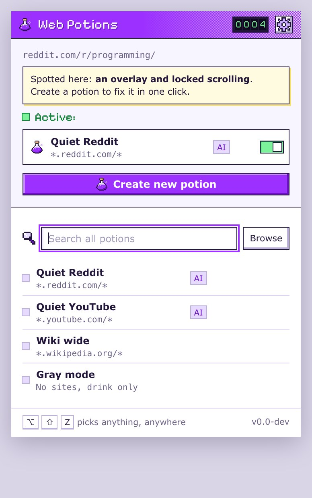

<p align="center">
  
</p>

<h1 align="center">Web Potions</h1>

<p align="center">
  <b>Brew the web you want.</b><br>
  Remove what bugs you, restyle what's ugly, highlight what matters,<br>
  and hide the overlays nobody asked for.
</p>

<p align="center">
  
</p>

You look at websites all day, and whatever they show you goes straight into your
head. Web Potions is a Chrome extension that lets you decide what gets through.

Every tweak is a **potion**: a small bundle of changes that runs by itself on the
sites you choose. Brew one by pointing and clicking, or pour in your own CSS and
JavaScript. One extension instead of a drawer full of half-working ones.

## Potion catalog

Ready-made potions to start with. Once Web Potions is installed, click **Browse** in
the toolbar popup and **Get** any of these. One click and it's on your shelf.

<!-- catalog:start -->
| Potion | Works on | What it does |
| --- | --- | --- |
| [Instagram, no pictures](potions/instagram-no-pictures.potion.json) | instagram.com | Every photo and video on Instagram turns invisible. Captions and comments stay. |
| [YouTube, no recommendations](potions/youtube-no-recommendations.potion.json) | youtube.com | The home feed, the Up next sidebar and end-screen suggestions disappear. Search and Subscriptions still work. |
| [YouTube, no Shorts](potions/youtube-no-shorts.potion.json) | youtube.com | Hides the Shorts tab, Shorts shelves, and Shorts in feeds and search results. |
| [Gray mode](potions/gray-mode.potion.json) | Any page, when you drink it | Drains the color out of any page. Less slot machine, more newspaper. |
| [Hide all images](potions/hide-all-images.potion.json) | Any page, when you drink it | Every image becomes a blank tile. Hover one to peek. |
| [Hype detector](potions/hype-detector.potion.json) | Any page, when you drink it | Lights up buzzwords, so you can see how hard a page is selling. |
| [Night mode](potions/night-mode.potion.json) | Any page, when you drink it | Turns any page dark by flipping its colors. Photos and videos stay normal. |
<!-- catalog:end -->

Brewed a good one? Share it as a `.potion.json`, drop it in [`potions/`](potions),
run `node scripts/build-catalog.mjs` and open a pull request.

## Install

Web Potions isn't on the Chrome Web Store. Loading it yourself takes a minute:

1. Download this repo (**Code → Download ZIP**, then unzip it) or `git clone` it.
2. Open `chrome://extensions` and switch on **Developer mode** (top right).
3. Click **Load unpacked** and choose the `extension` folder.
4. Click **Details** on Web Potions and switch on **Allow User Scripts**.
   Chrome asks for this before any extension can run your own scripts on pages.
5. Pin the purple potion to your toolbar.

Works in Chrome 135 and newer.

## Brew your first potion

1. On any page, click the potion in your toolbar, then **Create new potion**.
2. If the page has an overlay, a stuck banner or locked scrolling, it's already listed
   under **Spotted on this page**. Click **Fix**, or **Fix all**, and watch it go.
3. Add more ingredients from the grid, check **Works on**, and **Save potion**.

Next time you visit, the potion runs on its own, before the page has finished loading.

<p align="center">
  
</p>

## AI mode

Let an AI that drives your browser, like Claude in Chrome, fix sites for you. It looks at the page, tries a fix, reloads to check it, then saves what works and turns it on, with no clicks from you.

<p align="center">
  
</p>

**Set it up in two steps:**

1. Click the potion in your toolbar, then the gear, and switch on **AI mode**.
2. Click **Copy instructions for your AI** right there, paste them into your AI, and say what you want changed. To skip the pasting, copy [`extension/skill/web-potions`](extension/skill/web-potions) into its skills folder (for Claude Code, that's `~/.claude/skills/`).

Your AI has to drive your real Chrome, so use Claude in Chrome or something like it. Built-in browser panes and cloud browsers don't have your extensions, so an AI can't reach Web Potions from them.

**Turn things off** the same way you always would. Anything an AI saves is tagged <kbd>AI</kbd>.

<p align="center">
  
</p>

**Browse** has a switch for every potion you own, and that's where you delete them:

<p align="center">
  
</p>

### How it keeps websites out

A website's scripts can send the same messages your AI sends, so a switch alone wouldn't be safe. So the AI starts by pressing <kbd>Ctrl</kbd> <kbd>Alt</kbd> <kbd>Shift</kbd> <kbd>P</kbd> with its real keyboard action, which page scripts can't fake. That unlocks one tab for one site, until it leaves the site, closes the tab or 30 minutes pass.

- Until then, Web Potions doesn't answer page messages at all, so sites can't even tell it's installed.
- The first time an AI works on a site, a separate window asks you to allow it. About 100 popular sites skip the question, and you can switch that off in Settings. Email, banks, payments and dedicated sign-in sites are never on that list.
- The AI can only save potions for the site it's on. It can't touch other sites, every-site potions or iframes.
- The AI can't delete anything. It can only edit or switch potions on that site.
- While AI mode is on, the toolbar icon says **AI**, so you remember it's on.
- While an AI can act on a tab, a badge on the page says **Operated by AI**, and a card lets you lock it out.

> **The risk you accept by turning it on:** a page could trick your AI into saving a bad potion. That code would keep running on that site after the AI has gone, with no click to stop it first. So every save shows a card with an **Undo** button, and the `AI` tag makes these potions easy to find.

## Shortcuts

| Do this | To |
| --- | --- |
| Right-click anything → **Web Potions → Remove or edit this element** | Remove, blur or restyle that exact thing |
| Select text → right-click → **Web Potions → Highlight “…” on this site** | Make those words glow. Do it again to change the color |
| Right-click → **Web Potions → Drink a potion** | Run any potion once on this page |
| <kbd>Alt</kbd> <kbd>Shift</kbd> <kbd>Z</kbd> | Start picking elements |

While picking, hover to aim and click to open the menu. <kbd>↑</kbd> selects the
parent, <kbd>↓</kbd> goes back down, <kbd>Esc</kbd> stops. It works inside iframes
too.

## Ingredients

| Ingredient | What it does |
| --- | --- |
| **Pick & zap** | Remove, blur or restyle any element. Stored as CSS, so it sticks when the page re-renders |
| **Keyword glow** | Highlights words wherever they appear, iframes included |
| **Unlock scroll** | Gives you your scrollbar back, and keeps it there |
| **Image veil** | Blurs or blanks images until you hover them |
| **Custom CSS** | Your own stylesheet |
| **Custom JS** | Your own script, on a loop or once, right away or after a delay |

## The toolbar popup



**Active:** lists the potions that run on this site, each with a switch. The
bubbling ones are live right now.

**Search** finds any potion on your shelf so you can **Drink** it here, even when
its sites don't match. Sites only decide where a potion runs by itself.

Below that is your whole shelf, newest first.

**Browse**, or the counter at the top, opens a page with all your potions, each with a switch, and the
[catalog](#potion-catalog) of ready-made ones. The gear opens settings:
[AI mode](#ai-mode), export everything, import potions, change the shortcut.

<br clear="right">

## Sites

| Pattern | Matches |
| --- | --- |
| `*.reddit.com/*` | reddit.com and every subdomain |
| `reddit.com/r/*` | one section of a site |
| `news.ycombinator.com/item*` | pages that start with that |
| `https://example.com/exact/page` | that page only |
| `*` | everywhere |

## Custom JavaScript

Your script runs as an async function with a `potion` helper:

```js
const sidebar = await potion.waitFor('.sidebar'); // waits until it shows up
sidebar.remove();

potion.css('body { font-family: Georgia, serif }'); // taken out when the potion stops
potion.every(5000, () => console.log('still here', potion.runs));
potion.onStop(() => console.log('bye'));
```

**Repeat every** runs it again on a loop (0 runs it once). **First run after** waits
before the first run (0 runs it as soon as the page is ready). Scripts run in their
own isolated world. Tick **Run in the page's own context** to reach the page's own
variables, like the DevTools console does.

## Sharing

**Share** in the brewing window copies a potion as JSON or downloads it as a
`.potion.json` file. In settings you can export your whole shelf, and import a file
or pasted JSON. You see what's inside before anything is added.

> **Heads up:** a potion can carry JavaScript that runs on every site it matches.
> Only import potions from people you trust.

## Privacy

No servers, no analytics, no accounts. Your potions live in Chrome's local storage
for this extension and stay there unless you export them. The one thing Web Potions
fetches from the internet is the catalog, a plain file from this repo, when you open
**Browse**. Nothing about you goes with it.

AI mode is off until you turn it on, and Web Potions still sends nothing anywhere. Your
AI reads pages through its own browser tool, so what it sees goes wherever that AI sends
it.

## How it works

- `extension/background.js` registers each enabled potion with Chrome's
  [`userScripts`](https://developer.chrome.com/docs/extensions/reference/api/userScripts)
  API at `document_start`, so what you hid doesn't get a chance to flash.
- `extension/lib/brew.js` turns a potion into page code. CSS goes in as constructed
  stylesheets, and Keyword glow uses the CSS Highlight API (no changes to the page).
- `extension/content/` is the in-page UI (brewing window, picker, menus). It's injected
  only when you open it, inside a closed shadow root the page can't reach.
- `extension/popup/` is the toolbar popup. `extension/options/` is the Browse and
  Settings page.
- `extension/ai-bridge.js` is AI mode: the unlock, the limits and the AI's commands.
  `extension/content/ai-page.js` is what it sees on a page, and `extension/skill/web-potions/`
  teaches an AI how to use it.
- `potions/` is the catalog. Each potion is its own file; `catalog.json` bundles them
  for the Browse page.

Plain HTML, CSS and JavaScript. No build step, no dependencies.

## Development

```sh
python3 -m http.server 8765   # from the repo root
```

- <http://127.0.0.1:8765/dev/site.html> is a fake site with a pop-up and the full
  in-page UI, with `chrome.*` mocked. Drive it from the console: `wpUI('new')`,
  `wpUI('pick')`.
- <http://127.0.0.1:8765/dev/popup.html> is the popup with a sample shelf (add
  `?setup=1` or `?empty=1` for those states).
- <http://127.0.0.1:8765/dev/options.html#browse> is the Browse page, reading the
  catalog from your local `potions/` (add `?offline=1` to see it fail).
- <http://127.0.0.1:8765/dev/welcome.html> is the page that opens on install (add `?setup=1`
  to see the setup step still to do).
- <http://127.0.0.1:8765/dev/allow.html?site=reddit.com> is the window that asks before an AI
  works on a new site.
- <http://127.0.0.1:8765/dev/popups.html> is a plain page with a late pop-up and a
  swallowed scroll wheel, for testing AI mode with the real extension.
- `node scripts/test-ai-bridge.mjs` checks AI mode's limits against the real background
  code.
- `node scripts/build-catalog.mjs` checks every file in `potions/` and rebuilds
  `potions/catalog.json` and the catalog table in this README.
- `node scripts/make-icons.mjs` redraws the icons from the ASCII sprites in
  `extension/lib/pixels.js`.

After changing extension code, click ↻ on Web Potions in `chrome://extensions` and
reload the tab.

## License

[MIT](LICENSE). The bundled [Pixelify Sans](https://github.com/eifetx/Pixelify-Sans)
font is under the SIL Open Font License ([`extension/fonts/OFL.txt`](extension/fonts/OFL.txt)).

<p align="center"><sub>Best viewed in your own way.</sub></p>
